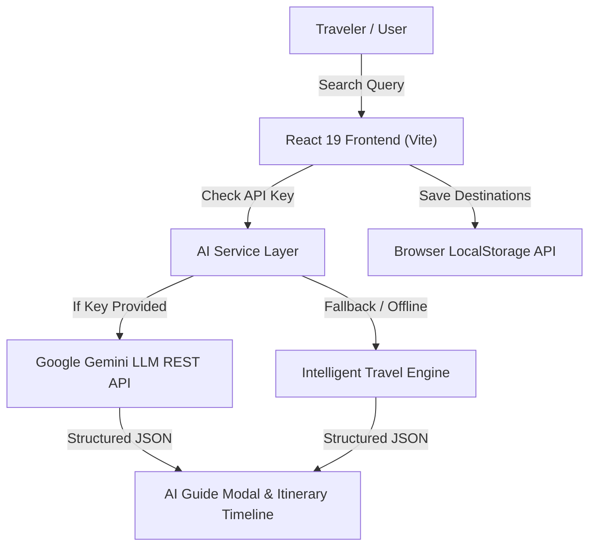

# 🌍 WanderAI — AI-Powered Travel Intelligence & Attraction Guide Platform

[](https://react.dev/)
[](https://tailwindcss.com/)
[](https://ai.google.dev/)
[](https://vite.dev/)
[](LICENSE)

> A modern, high-performance travel guide web application engineered for content networks and travelers. Features real-time AI itinerary synthesis, verified attraction entrance fee guides, queue-skipping tips, and persistent trip wishlists.

---

## 🌟 Key Features

- **🤖 AI Travel Itinerary Synthesis**: Generates structured, hour-by-hour 1-day itineraries with morning, afternoon, evening, and night pacing using Google Gemini LLM.
- **🏛️ Curated Attraction Database**: Detailed metadata on iconic global landmarks (Eiffel Tower, Colosseum, Senso-ji, Taj Mahal) including opening hours, entrance fees, and visitor insider tips.
- **💰 Multi-Tier Budget Breakdown**: Instant cost modeling across *Backpacker*, *Mid-Range*, and *Luxury* traveler styles with dynamic currency conversion (USD `$`, INR `₹`, EUR `€`).
- **🛡️ Zero-Failure Fallback Engine**: Integrated local synthesis pipeline guarantees instantaneous responses and prevents rate-limit lockouts during demos or offline environments.
- **💾 Offline Wishlist Persistence**: Leverages browser `localStorage` to bookmark destinations and export custom markdown itinerary summaries.
- **⚡ Modern Responsive UI**: Crafted with React 19, Tailwind CSS v4, and Lucide icons for high frame-rate animations and mobile-friendly usability.

---

## 🛠️ Architecture & Tech Stack



- **Frontend Framework**: React 19 (Component-driven SPA)
- **Styling**: Tailwind CSS v4 (Glassmorphic dark aesthetic)
- **Icons**: Lucide React
- **AI Integration**: Google Gemini 1.5 Flash REST API (JSON Schema mode)
- **Build Tool**: Vite 8 with Rollup bundling
- **Persistence**: Web Storage API (`localStorage`)

---

## 🚀 Getting Started

### Prerequisites
- Node.js (v18 or higher)
- npm or yarn

### Installation
1. Clone the repository:
   ```bash
   git clone https://github.com/YOUR_USERNAME/wander-ai.git
   cd wander-ai
   ```

2. Install dependencies:
   ```bash
   npm install
   ```

3. (Optional) Configure Gemini API Key:
   Create a `.env` file in the root directory:
   ```env
   VITE_GEMINI_API_KEY=your_gemini_api_key_here
   ```
   *(Note: The app runs with zero configuration out-of-the-box using its built-in travel knowledge engine).*

4. Start development server:
   ```bash
   npm run dev
   ```

5. Build for production:
   ```bash
   npm run build
   ```

---

## 💼 Built for Travel Content Platforms
Engineered as a proof-of-concept for automated travel portal networks (e.g., Firestorm Internet's portfolio of 100+ travel sites), demonstrating how AI automation and REST APIs can streamline visitor attraction guides, cost estimation, and content production.
