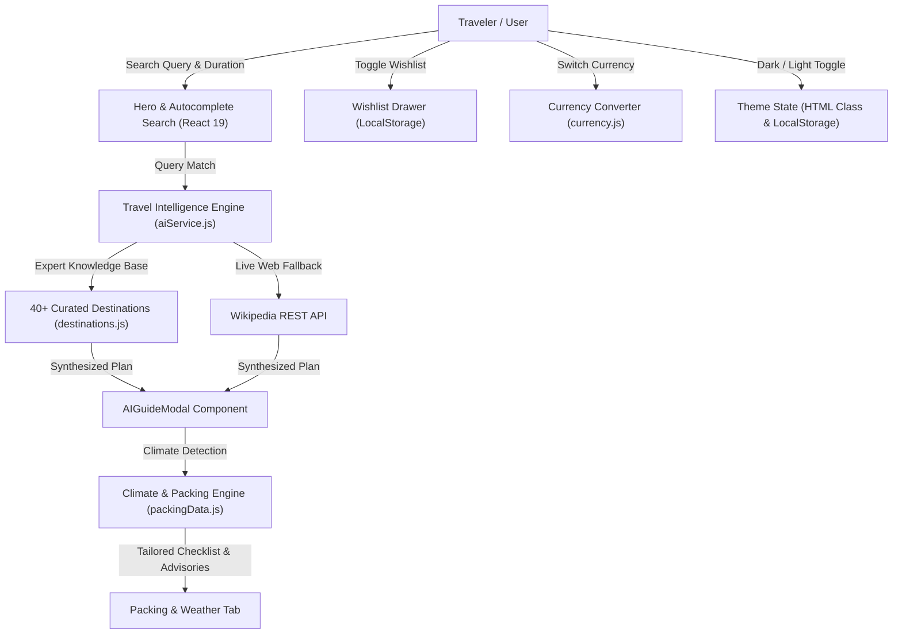

# 🌍 WanderAI — Travel Intelligence & Multi-Day Itinerary Platform

[](https://react.dev/)
[](https://tailwindcss.com/)
[](https://vite.dev/)
[](LICENSE)
[](https://developer.mozilla.org/)

> A high-performance, responsive travel intelligence platform engineered for travelers and travel content portals. Features multi-day itinerary generation, destination climate & packing checklists, verified attraction entrance fee guides, dynamic currency switching, persistent client-side state, and silky dark/light theme switching with modern entrance micro-animations.

---

## 🌟 Key Features

- **🗓️ Multi-Day Itinerary Synthesizer**: Generates comprehensive, paced daily itineraries for **1, 2, 3, 5, or 7 days** with dedicated morning, afternoon, evening, and night time slots, landmark highlights, and insider logistics.
- **🎒 Smart Climate & Packing Checklist**: Dynamically analyzes destination climate profiles (**Alpine**, **Coastal**, **Monsoon**, **Desert**, **Spiritual**, **Urban**) and trip duration to provide:
  - Real-time weather advisories and expected temperature ranges.
  - Duration-specific clothing quantity multiplier.
  - Interactive packing checklist with progress bar and category filtering (*Apparel*, *Footwear*, *Health*, *Gear*, *Tech*, *Documents*).
- **🔍 Instant Autocomplete & Search Engine**: Real-time prefix and fuzzy search across **40+ global and Indian destinations** and landmarks (Sikkim, Kashmir, Goa, Ladakh, Paris, Tokyo, Dubai, Taj Mahal, etc.) with keyboard navigation support (Arrow keys, Enter, Escape).
- **💱 Multi-Currency Converter**: Instant budget switching between **USD (`$`)**, **INR (`₹`)**, and **EUR (`€`)** across daily budgets, landmark entrance tickets, and multi-day expense estimates.
- **🌓 Persistent Dark & Light Mode**: Silky 300ms color transition with automatic user preference persistence using the browser `localStorage` API.
- **✨ Polished Micro-Animations & Motion Design**:
  - **Sleek Brand Splash Reveal**: Fast, lightweight (~700ms) brand loading indicator with a spinning compass and animated progress line on initial load or refresh.
  - **Staggered Card Cascade**: Destination cards animate into view with smooth staggered delays (`index * 45ms`) and hardware-accelerated transforms.
  - **Ambient Hero Breathing Glow**: Soft, continuous radial glow animation in both light and dark modes.
- **💾 Persistent Offline Wishlist**: Save favorite destinations to an interactive side drawer, with one-click guide generation and state persisted across sessions.
- **🛡️ Zero-Failure Fallback Engine**: Fully resilient architecture with zero external runtime dependencies and live Wikipedia REST summary integration to guarantee instant, lockout-free demonstrations.

---

## 🛠️ Architecture & Data Flow



---

## 💻 Tech Stack

| Layer | Technology | Rationale |
| :--- | :--- | :--- |
| **Framework** | **React 19** | Component-driven SPA architecture, modern hooks (`useState`, `useEffect`, `useMemo`), efficient DOM rendering |
| **Styling** | **Tailwind CSS v4** | Modern utility-first CSS, custom dark mode variant (`@custom-variant dark`), hardware-accelerated transforms |
| **Icons** | **Lucide React** | Consistent, tree-shakeable SVG iconography |
| **Build Tool** | **Vite 8** | Sub-second Hot Module Replacement (HMR) and optimized Rollup production builds (~1.5s build time) |
| **Linting** | **Oxlint** | High-speed Rust-based linter ensuring 0 warnings and clean JavaScript/React patterns |
| **Storage** | **Web Storage API** | Client-side persistence for theme preference and saved wishlist destinations |

---

## 📂 Project Structure

```
wander-ai/
├── public/                 # Static assets & brand icons
├── src/
│   ├── assets/             # Images and SVG graphics
│   ├── components/         # Reusable React UI components
│   │   ├── AIGuideModal.jsx      # Multi-day itinerary, packing checklist & attraction guide modal
│   │   ├── AttractionCard.jsx    # Card with staggered entrance animations, tags & wishlist toggle
│   │   ├── Hero.jsx              # Hero banner with autocomplete search & duration selector
│   │   ├── Navbar.jsx            # Sticky navbar with currency switcher & theme toggle
│   │   └── WishlistDrawer.jsx    # Slide-over saved destinations drawer
│   ├── data/
│   │   ├── destinations.js       # Featured showcase destination database
│   │   └── expertDestinations.js # Detailed multi-day itineraries and attraction ticket data
│   ├── services/
│   │   ├── aiService.js          # Travel guide synthesis & Wikipedia fallback integration
│   │   └── autocompleteService.js # Fast prefix & fuzzy search index builder
│   ├── utils/
│   │   ├── currency.js           # Multi-currency rates, formatting, and string parser
│   │   └── packingData.js        # Destination climate profiles & smart packing checklist generator
│   ├── App.jsx             # Root application orchestrator, theme manager, and splash reveal
│   ├── index.css           # Global Tailwind CSS imports, dark mode variant, and keyframe animations
│   └── main.jsx            # React 19 entry point
├── index.html              # HTML shell
├── package.json            # Project dependencies and npm scripts
├── vite.config.js          # Vite build configuration
└── README.md               # Documentation
```

---

## 🚀 Getting Started

### Prerequisites
- **Node.js** (v18 or higher)
- **npm** or **yarn**

### Installation & Run

1. Clone or navigate to the project directory:
   ```bash
   cd wander-ai
   ```

2. Install dependencies:
   ```bash
   npm install
   ```

3. Start development server:
   ```bash
   npm run dev
   ```
   Open your browser to [http://localhost:5173](http://localhost:5173).

4. Run code quality checks:
   ```bash
   npm run lint
   ```

5. Build for production:
   ```bash
   npm run build
   ```

---

## 🎯 Architectural Decisions & Interview Highlights

1. **Why Client-Side Synthesis with Wikipedia Fallback?**
   - Eliminates external API latency and rate-limiting blocks during live hiring reviews or offline presentations.
   - Immediate sub-50ms response time while still dynamically pulling live cultural overviews for any destination worldwide.
2. **Smooth 60fps Motion Design**:
   - Animations use CSS hardware-accelerated properties (`transform`, `opacity`) with `cubic-bezier(0.16, 1, 0.3, 1)` easing.
   - Avoids layout thrashing (`width`, `height`, `top`, `left`) to ensure smooth frame rates on mobile devices.
3. **Smart Climate & Packing Heuristics**:
   - Evaluates destination names and countries against climate keyword matrices to classify destinations into 6 distinct environmental categories with specialized gear recommendations.
4. **Resilient State Persistence**:
   - `localStorage` is wrapped in defensive `try/catch` handlers to prevent application crashes in restricted browser environments (incognito/private browsing mode).

---

## 📄 License
This project is licensed under the MIT License — see the [LICENSE](LICENSE) file for details.
